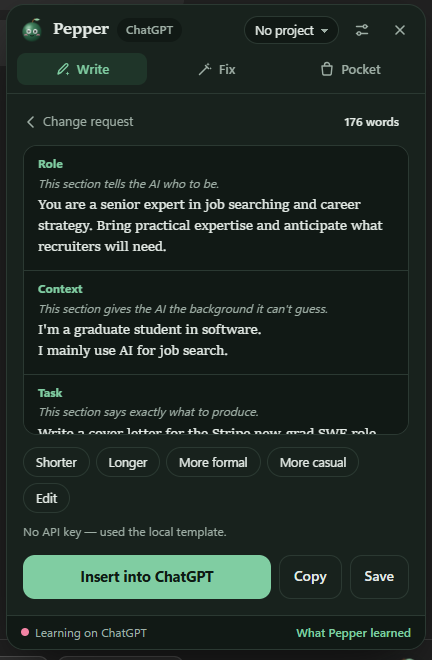
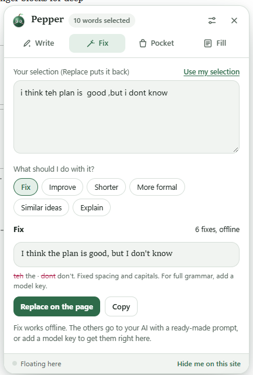
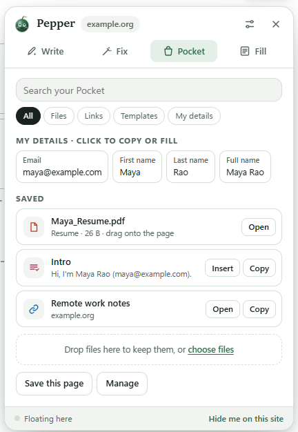
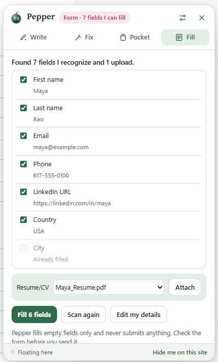

# Pepper — The Personal AI Prompter

**A small companion for Chrome, Brave and Edge that floats on your screen. It turns a few rough words into a clear, six-part prompt built from what you've told it about yourself, fixes your writing on any page, keeps your resume, files, links and details one click away, and fills job applications. Everything stays in your browser. Pepper never sends anything for you.**

[](https://github.com/amoghmaddur/pepper-ai-prompter/actions/workflows/tests.yml)


### [▶ Try the prompt engine in your browser](https://amoghmaddur.github.io/pepper-ai-prompter/) · [What's new in 0.4](CHANGELOG.md)

<table>
<tr>
<td width="25%"></td>
<td width="25%"></td>
<td width="25%"></td>
<td width="25%"></td>
</tr>
<tr>
<td><b>Write.</b> A six-part prompt from your profile, in the AI's own box. Starts on the approach that fits how you think.</td>
<td><b>Fix.</b> Select text anywhere. Spelling and spacing fixed offline; improve, shorten or get similar ideas with your model.</td>
<td><b>Pocket.</b> Resume, files, links, templates and your details. Drag files onto any upload field.</td>
<td><b>Fill.</b> Job forms filled from your details in one click. Only empty fields, never submitted.</td>
</tr>
</table>

## Install

1. Download **`pepper-v0.4.0.zip`** from [Releases](https://github.com/amoghmaddur/pepper-ai-prompter/releases) and unzip it, or build it yourself with `node pepper-tests/tools/package.js`.
2. Open `chrome://extensions` (`brave://extensions`, `edge://extensions`) and turn on **Developer mode**.
3. Click **Load unpacked** and pick the unzipped **`pepper-v0.4.0`** folder, the one with `manifest.json` directly inside.

> **"Manifest file is missing or unreadable"?** You picked a folder one level too high, such as the repository itself. Choose `pepper-v0.4.0` (or, in the repository, `pepper-extension`).

Pepper's setup opens: about two minutes, one question per screen. Its features unlock when you finish.

## What it does

- **Setup that shapes everything.** What to call you, what you do, which AI sites you use (in order), what you use AI for, how you like answers, your tone, when you do your best work, where Pepper floats, and which features you want, each with a preview.
- **It leans the way you think.** "Walk me through it" starts prompts on Clarify, "Get to the point" on Leaner. Your first-pick AI is where prompts from other pages go. Once you've rated 5 replies, Pepper starts on your best-rated approach and tells you why.
- **Floats where you want.** Only on the five AI sites, or everywhere (your browser asks once). Alt+Shift+P, the toolbar button or the right-click menu calls it on any page. Hide it on any site.
- **A character, not a button.** The peppercorn blinks, follows your pointer, smiles when something worked, and goes wherever you drag it.
- **Write anywhere, send to your AI.** On ChatGPT, Claude, Gemini, Perplexity or Copilot, Insert puts the prompt in the box. On any other page, Pepper opens your AI with the prompt in the box, optionally with the page as source material. You press send.
- **Assumptions held back.** With your own model key, anything the model guessed about you is listed separately and stays out of the prompt until you confirm it.
- **Focus nudges.** An optional notification when your best hours start, with your goal and your AI one click away.

## Built with care

- **Your data stays here.** Everything lives in `chrome.storage.local`. No Pepper server, account or analytics. Every-site access and notifications are *optional* permissions, requested only when you turn those on.
- **Never acts for you.** Pepper never presses send, never submits a form, fills only empty fields, and refuses to store or fill passwords, card numbers and ID numbers.
- **Injection-resistant.** File and page text travel as labelled data blocks, never as instructions, and fake closing tags are defused, so "ignore previous instructions" in a resume can't change the prompt's Role.
- **Pages can't steer it.** The panel lives in a closed shadow root. Web pages may only make a short whitelist of writes (links and text to the Pocket, history where you allowed learning); prompt hand-offs can only be claimed by the tab Pepper opened, on the right site.
- **No lost writes.** Every list write goes through one serialized queue in the service worker; a control test shows the same race losing records without it.
- **Consent per site, off by default.** Learning records only on AI sites you turn it on for, and turning it off mid-reply discards the pending record.

## Tested

| | What | Result |
|---|---|---|
| Unit | 129 tests: prompt engine, autofill matching, quick fixes, reminders, the Pocket, onboarding rules, the real worker in a fake Chrome with racing storage, page wiring, the privacy notice, the package | **129 / 129** |
| Browser | 35 checks with the extension loaded: onboarding, every tool, insert without sending, hand-offs, drag and attach, form filling, consent gates, closed shadow root, data controls | **35 / 35 in Chromium 153, Brave 157 and Edge 154** |
| Live sites | Logged out, 2026-11-22: Pepper appears, opens and inserts into the real box, nothing sent | **Gemini ✓, Perplexity ✓**. ChatGPT and Claude show bot checks to automated browsers; Copilot asks for sign-in |

```bash
cd pepper-tests
npm test                                   # unit tests, no install needed
npm install && npx playwright install chromium
npm run test:browser                       # PEPPER_BROWSER=brave or msedge to switch
node e2e/live-check.js                     # the real sites, logged out; never sends
```

## Repository layout

| Path | What's there |
|---|---|
| [`pepper-extension/`](pepper-extension) | The extension: `manifest.json`, `background.js`, `content.js` (the floating companion), `lib/core.js` (prompt engine), `lib/assist.js` (autofill, fixes, reminders, Pocket), the onboarding, dashboard and popup pages, and the [privacy notice](pepper-extension/PRIVACY.md) |
| [`pepper-tests/`](pepper-tests) | Unit and browser tests, mock sites, the live check, and tools to build the package and the privacy page |
| [`demo/`](demo) | The [web playground](https://amoghmaddur.github.io/pepper-ai-prompter/) that runs the real prompt engine, and the walkthrough video |
| [`docs/`](docs) | Live-site test protocol, interview guide, and the v0.3 report |

## Honest limits

- AI sites redesign often. Gemini and Perplexity were checked live; ChatGPT and Claude were checked on faithful mock pages, because they block automated browsers. Please try them in your own browser.
- Microsoft Edge blocks all extensions on Copilot by design; Copilot works in Chrome and Brave.
- PDF text isn't read (Word files are); paste a PDF's text into its Pocket entry if prompts should use it.
- Branded Google Chrome can't be driven by test automation with an extension loaded, so the automated runs use Chromium, the open-source build Chrome is made from.

---

Built by **Amogh Maddur**.
