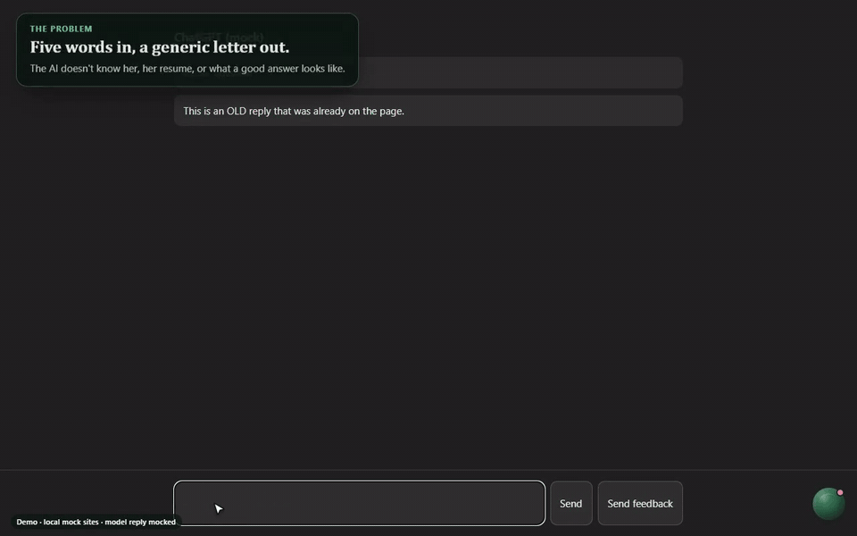
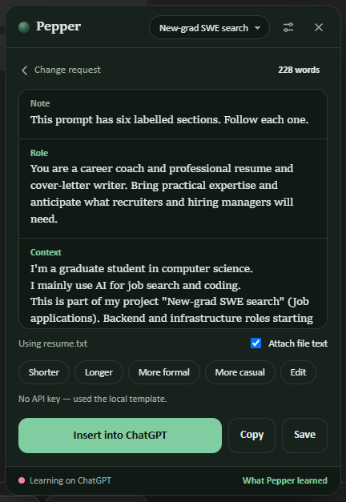
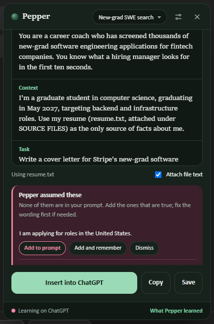
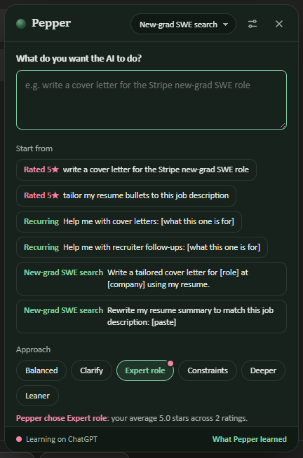
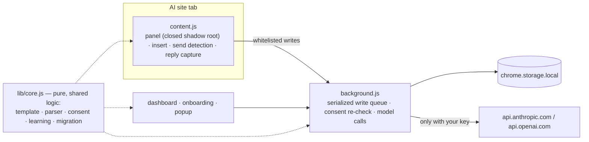

# Pepper — The Personal AI Prompter

**A Chrome and Edge extension that turns a few rough words into a clear, six-part prompt built only from what you've told it about yourself, then places it in the chat box of ChatGPT, Claude, Gemini, Perplexity or Copilot. You read it and press send. Pepper never sends anything for you.**

[](https://github.com/amoghmaddur/pepper-ai-prompter/actions/workflows/tests.yml)


### [▶ Try the live playground](https://amoghmaddur.github.io/pepper-ai-prompter/) · [Watch the 2-minute demo (MP4)](demo/media/pepper-demo.mp4)



<sub>Recorded with Playwright driving the real extension in Microsoft Edge, on local mock pages with a mocked model reply. The script is [`demo/record/record-demo.js`](demo/record/record-demo.js).</sub>

---

## The problem

Most people type five words into an AI chat and get a generic answer back. The AI doesn't know who they are, what they're working on, or what a good answer looks like. Writing a strong prompt each time takes effort nobody spends.

## What Pepper does

| You type | Pepper writes |
|---|---|
| `write a cover letter for the Stripe new-grad SWE role` | **ROLE** a career coach and cover-letter writer · **CONTEXT** your role, goals, saved memories, project and resume · **TASK** the request, broken into steps · **CONSTRAINTS** your tone, length, audience and things to avoid · **OUTPUT FORMAT** how you like answers laid out · **SUCCESS CRITERIA** how to tell the answer is done |

<table>
<tr>
<td width="33%"></td>
<td width="33%"></td>
<td width="33%"></td>
</tr>
<tr>
<td><b>Six labelled parts</b>, from 15 profile answers, memories and project files. Works offline with an on-device template, or with your own Anthropic or OpenAI key.</td>
<td><b>Assumptions held back.</b> Anything the model guessed about you is listed separately and never inserted until you confirm it.</td>
<td><b>Learns what works.</b> After five ratings, Pepper starts on your best-rated approach for that kind of work and tells you why.</td>
</tr>
</table>

### Features

- **Five sites, one panel.** A draggable peppercorn (or `Alt+Shift+P`) opens Pepper on ChatGPT, Claude, Gemini, Perplexity and Copilot. The panel follows each site's light or dark theme.
- **Every answer matters.** Each of the 15 profile questions has a defined, tested effect on the prompt (role, tone, audience, language, length tier and more).
- **Six approaches:** Balanced, Clarify, Expert role, Constraints, Deeper and Leaner, plus one-click Shorter, Longer, More formal and More casual rewrites.
- **Projects and files.** Attach a resume or notes to a project. File text travels as labelled data blocks within a per-file and per-prompt budget, and anything trimmed is marked.
- **Learning you can see and reset.** Per kind of work, Pepper learns the approach, a target length from your 4–5 star prompts, and "worked well before" suggestions. With a key, it can offer facts you stated about yourself as memories. You confirm every one.
- **Dashboard** with profile, memories, projects, saved prompts, searchable history, what Pepper learned, privacy controls and model settings.

## Engineering highlights

- **Privacy by construction.** Everything is stored in `chrome.storage.local`. There's no Pepper server, account or analytics. The manifest asks for only `storage` and `unlimitedStorage`, plus host access to the two model providers. Learning is **off by default on every site**, with one switch per site. Turning it off mid-reply discards the pending record.
- **Prompt-injection resistant.** File text is never mixed into Pepper's instructions. It goes in a `<file>` data block with a preamble, and fake closing tags are defused, so a file saying "ignore previous instructions" can't change the Role. Unit tests cover this for all six approaches.
- **No invented facts.** The model must list facts it would need after an `===ASSUMPTIONS===` marker. The parser separates them, handles a missing or malformed marker with a visible warning, and only the prompt half can ever be inserted.
- **No lost writes.** Every list write from every tab goes through one serialized queue in the service worker, which re-checks consent before saving anything from a web page and whitelists what content scripts may write. A control test reproduces the two-tab race without the queue and shows it losing records.
- **Hardened UI.** The panel lives in a closed shadow root, so page scripts can't read it or the API key. Extension pages can't be framed (`frame-ancestors 'none'`), and messages from other extensions are ignored.
- **Honest attribution.** A send counts as "written with Pepper" only within 10 minutes of an Insert and at ≥ 50% Levenshtein similarity, so unrelated sends can't skew learning.
- **Safe upgrades.** A schema migration converts v0.2 data idempotently, keeping every record and reference. History is pruned to 90 days or 2,000 prompts.



## Tested

| Suite | What runs | Result |
|---|---|---|
| Unit (`node --test`) | 75 tests on `lib/core.js` and the real `background.js` inside a fake Chrome whose storage adds random delays, so concurrency bugs are real | **75 / 75 pass** |
| Browser (Playwright) | 20 checks with the extension loaded in a real browser, driving mock pages for all five sites: insert without sending, clipboard fallback, reply capture, consent gates, the closed shadow root, framing, data controls and learning | **20 / 20 pass** on Microsoft Edge 154, and on Chromium in CI |

```bash
cd pepper-tests && npm test                    # unit tests, no install needed
npm install && npx playwright install chromium
npm run test:browser                           # browser checks (PEPPER_CHANNEL=msedge to use Edge)
```

## Install

1. Download this repository (**Code → Download ZIP**) and unzip it.
2. Open `chrome://extensions` (or `edge://extensions`) and turn on **Developer mode**.
3. Click **Load unpacked** and choose the `pepper-extension` folder.
4. The welcome page opens. Choose where Pepper may learn, optionally add a model key, and answer three questions. Then open any of the five sites and click the green peppercorn.

## Repository layout

| Path | What's there |
|---|---|
| [`pepper-extension/`](pepper-extension) | The extension: `manifest.json`, `background.js`, `content.js`, `lib/core.js`, dashboard, onboarding, popup, [privacy notice](pepper-extension/PRIVACY.md) and its own [README](pepper-extension/README.md) |
| [`pepper-tests/`](pepper-tests) | Unit tests, the fake Chrome, Playwright browser tests and mock sites |
| [`demo/`](demo) | The [live playground](https://amoghmaddur.github.io/pepper-ai-prompter/) (runs the real `core.js` in the browser), the demo video and its recording script |
| [`docs/`](docs) | Live-site test protocol and user interview guide |
| [`CHANGES.md`](CHANGES.md) | What changed from v0.2 to v0.3, with the evidence for each item |

## Honest limits

- Site selectors are tested against local mock pages only. AI sites change their markup often, so [`docs/LIVE-TEST-PROTOCOL.md`](docs/LIVE-TEST-PROTOCOL.md) covers checking them on the live sites.
- **Copilot works in Chrome but not in Edge.** Since Edge 150, Microsoft blocks every third-party extension on `copilot.microsoft.com`, and no policy overrides it.
- PDF and Word files aren't parsed; paste their text into a project.
- The privacy notice is a draft that still needs legal review.

---

Built by **Amogh Maddur**.
